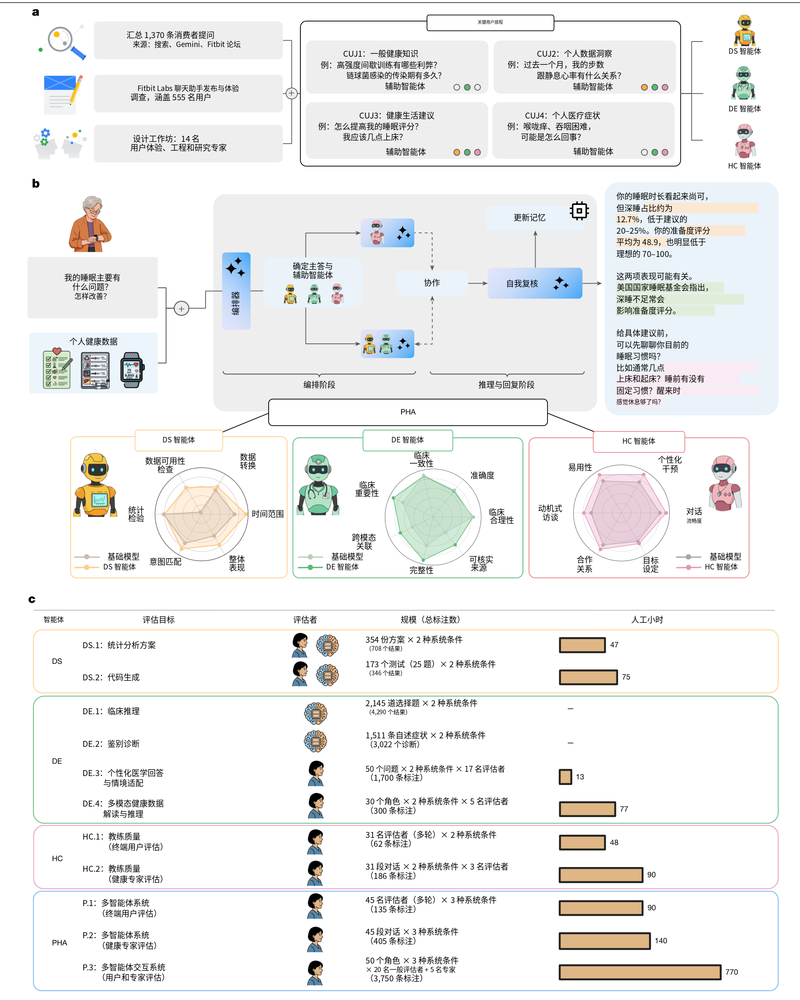
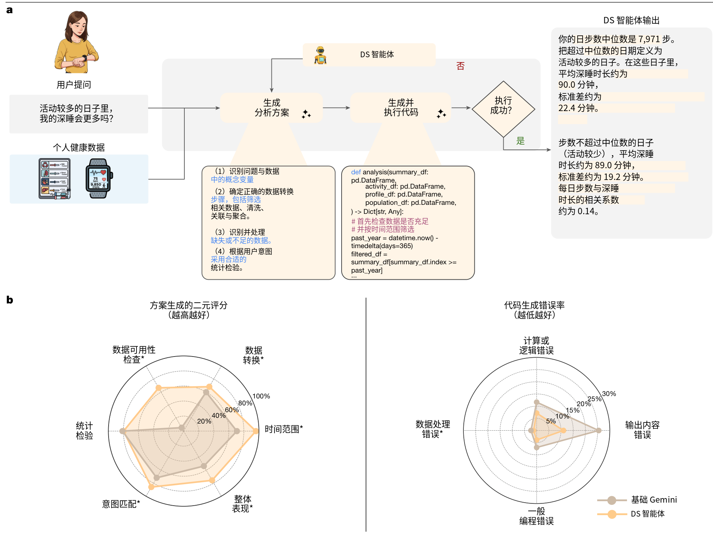
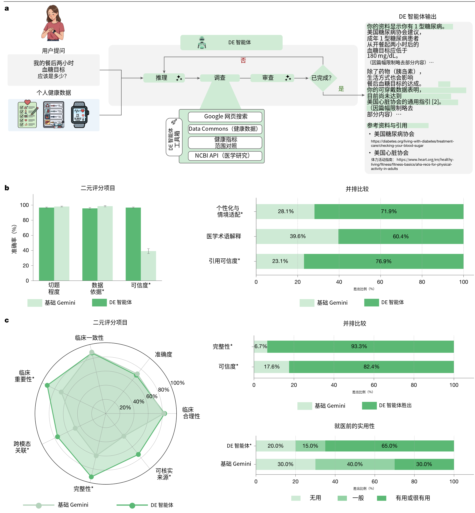
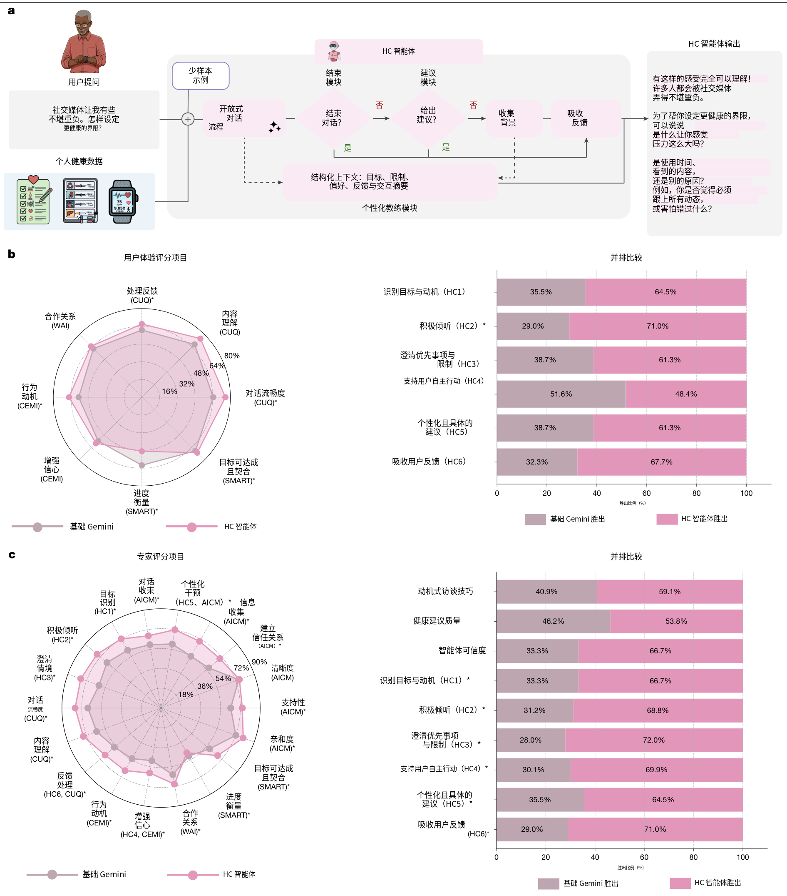
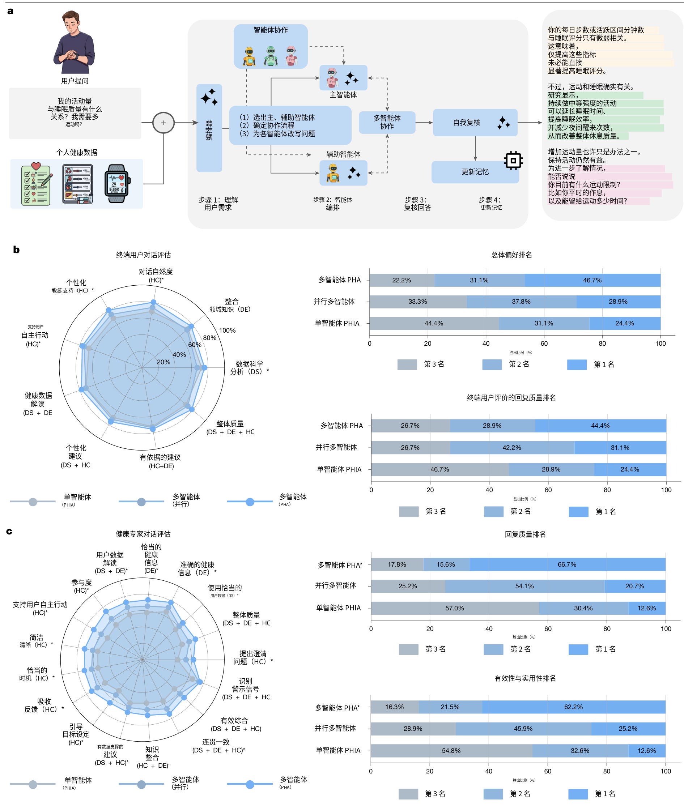

# 个人健康智能体的架构解析

*The Anatomy of a Personal Health Agent* · Nature 659, 197–207 (2026) · 2026 年 10 月 21 日在线发表

**原作者** A. Ali Heydari、Ken Gu、Vidya Srinivas、Hong Yu、Akshay Paruchuri、Zhihan Zhang、Yuwei Zhang、Qian He、Hamid Palangi、Nova Hammerquist、Ahmed A. Metwally、Brent Winslow、Yubin Kim、Kumar Ayush、Yuzhe Yang、Girish Narayanswamy、Maxwell A. Xu、Jake Garrison、Samuel Schmidgall、Amy Armento Lee、Jenny Vafeiadou、Ben Graef、Isaac R. Galatzer-Levy、Erik Schenck、Andrew Barakat、Javier Perez、Jacqueline Shreibati、John Hernandez、Anthony Z. Faranesh、Naghmeh Rezaei、Javier L. Prieto、Conor Heneghan、Jiening Zhan、Mark Malhotra、Shwetak Patel、Yun Liu、Tim Althoff、Xin Liu、Daniel McDuff、Xuhai Orson Xu。

**版本与许可** 本文件是 Nature 正式版的简体中文译文，保留章节结构，并在对应章节插入正文图 1–5 的中文版。图中的曲线、数值、代码和缩写沿用原图。参考文献、扩展数据图及补充材料请对照原刊。部分方法段落对重复说明和补充细节作了压缩，正文的逐条文献编号请以原刊为准。原文 © 原作者 2026，依 [CC BY 4.0](https://creativecommons.org/licenses/by/4.0/) 授权。[正式版及补充材料入口](https://doi.org/10.1038/s41586-026-11161-8)

## 摘要

大语言模型正在推动新一代健康智能体的发展，但这些系统能否满足人们日常生活中多样的健康需求，仍有待探索。我们开发了一套综合性的个人健康智能体，可以对消费级健康设备和医疗记录中的多模态数据进行推理，从而提供个性化健康支持。

我们分析了网络搜索与健康论坛中的问题，并开展了有终端用户和健康专家参与的以用户为中心的研究。研究识别出四类关键用户旅程：了解一般健康知识、解读个人数据、获取健康生活建议，以及评估症状。基于这些旅程，我们设计了三个专业子智能体。数据科学智能体分析可穿戴设备和医疗记录中的纵向数据，并借助人群统计数据解释个人数值。健康领域专家智能体结合个人数据、情境信息和健康知识，生成个性化洞察。健康教练智能体综合这些洞察，支持多轮互动和目标设定，采用指定的心理学策略，并跟踪进展。

我们将这些能力整合为开源的个人健康智能体（PHA）框架，用于动态、个性化的健康互动。我们通过自动评估和人工评估，在 11 项基准任务上检验了各子智能体和完整系统。健康专家与终端用户共提供了 7,000 多条标注，投入约 1,350 小时。按作者所知，这是当时对个人健康智能体最全面的评估，为拓宽高质量个性化健康支持的可及性提供了具体基础。

## 正文

大语言模型（LLM）的快速发展带来了健康领域的变化。现有模型可以辅助医疗文书、诊断、决策支持与药物发现等临床任务，也可以用于虚拟健康助手、症状自查工具、数字教练和顾问，以及模拟临床问诊。

可穿戴设备持续记录活动、睡眠、心率变异性等生理信号，为健康支持提供纵向上下文。近期系统已开始把这些数据接入大语言模型，但模型对数值时间序列的推理仍不可靠。既往系统有的覆盖狭窄的运动或睡眠问题，缺少深入的数值分析。有的能回答更广泛的数值问题，却缺少对专业健康知识和互动式教练能力的评估。综合系统需要把这些能力放在一起，同时维持连贯的互动。结合这些进展和个人健康需求之间的关联，我们认为智能化的个人健康助手正在成为可能。

日常健康和健康生活支持需求高度多样。我们采用以用户为中心的设计过程，结合终端用户的提问与讨论、调查和专家工作坊，覆盖日常健康、健身及医疗主题。结果识别出一般健康知识、个人数据解读、健康生活建议和健康症状四类需求。个人数据问题要求准确计算，有时需要执行代码。教练需要开放、富有同理心的对话。知识和症状问题则需要可靠的事实依据。实验表明，单一的大语言模型架构难以同时兼顾这些目标。因此，我们采用模块化多智能体架构，把不同需求交给对应的流程，再通过编排和综合维持统一的用户体验。

数据科学智能体（DS）把个人和人群层面的时间序列转换成量化分析，例如估算跑步表现的变化。领域专家智能体（DE）结合可穿戴数据、健康知识和可获得的医疗记录，例如解释某项生物标志物读数。本研究受数据访问协议限制，医疗记录只包括血液检测结果，未来可以进一步整合电子健康记录。健康教练智能体（HC）使用动机式访谈等循证策略，帮助用户设定目标、识别障碍并改变行为。很多问题涉及多个角色。我们参考了投票、迭代、辩论和分层组队等多智能体协作方式，设计了一个可以分配任务、综合输出的编排器。PHA 的研究目标是探索如何通过统一的助手向消费者提供更全面、可执行的健康洞察。医疗服务仍由专业人员提供。

我们的评估框架与用户研究识别出的能力相对应。我们测试 DS 生成稳健分析方案及代码的能力，测试 DE 的事实性和循证推理能力，并通过终端用户与专家研究测试 HC 的教练能力。随后，我们用反映多种健康场景的开放式多模态对话评估完整 PHA。11 项基准任务包含超过 7,000 条人工标注，终端用户和专家分别投入 651 和 699 小时。各专业子智能体在其目标能力上表现出优势，综合系统也显示出面向实际场景的应用潜力。模块化架构、对应能力的评估以及开源实现，共同为开发、比较和测试面向日常健康的 PHA 提供可复现的基础。

### 以用户为中心的健康需求分析

我们综合了搜索引擎和健康论坛中的 1,370 个消费者问题、555 名用户的健康目标调查，以及由 14 名用户体验与工程等领域专家参加的设计工作坊，识别出四类关键用户旅程（CUJ；图 1a）。

1. **一般健康知识。** 用户想了解一般健康主题、疾病或健康生活概念，例如高强度间歇训练有哪些利弊。
2. **个人数据洞察。** 用户想读懂可穿戴设备或医疗记录中的个人数据，找出趋势与关联，例如这个月的步数与静息心率有什么关系。
3. **健康生活建议。** 用户希望得到可执行的个性化建议，以改善健康或实现目标，例如为了改善睡眠评分，应该几点上床。
4. **个人医疗症状。** 用户描述自己的症状，希望了解可能的原因，例如喉咙发痒、吞咽困难可能是怎么回事。

补充表 1 给出了更细的分类。同一段对话往往跨越几类旅程，因此架构需要同时涵盖数据分析、健康领域推理和教练支持。

### 模块化的多智能体健康架构

PHA 由三个互补的专业智能体组成（图 1b）。

DS 分析个人时间序列并提供定量洞察。现有研究已探索将 LLM 用于数据科学任务，但模型能否理解含糊的开放式健康问题，并执行统计上合理的分析，仍是一个重要缺口。DS 负责把这类提问转成稳健的分析方案和准确的计算代码。扩展数据图 1 展示了对话示例。

DE 为用户数据补充有证据支持的临床语境。既往工作重点评估了模型的医学知识；对于在可穿戴设备、实验室检查和用户情境等多模态个人信息间进行推理和综合，研究相对有限。DE 通过一套工具整合各类数据，提供准确且贴合个人情况的解释。扩展数据图 2 给出了示例。

HC 通过多轮对话帮助用户设定目标和改变行为。人工智能教练是一个新兴方向，现有系统在广泛的日常健康主题上支持开放式对话的能力仍有限。我们用模块化架构帮助教练在收集信息和提供可执行建议之间取得平衡。扩展数据图 3 和图 4 给出了对话示例。

完整的 PHA 由中央编排器动态管理工作流。它拆解提问，分配任务，并通过迭代检查综合输出，最后给出一条连贯且考虑上下文的回复。扩展数据图 5–8 提供了多轮示例。图 1a 展示用户旅程与专业智能体的对应关系。例如，用户既想理解过去一周的睡眠数据，又想知道怎样改善睡眠时，DS 可以分析可穿戴数据，DE 可以提供循证睡眠知识，HC 可以给出个性化建议。补充表 1 列出了 26 种问题子类型及相应的主、辅助智能体。

我们基于 1,165 人参与的 WEAR-ME（利用可穿戴设备研究代谢健康）研究开展评估。数据经过质量检查，例如筛除佩戴期太短、佩戴不可靠或缺失率过高的记录。数据包括纵向可穿戴数据、临床血检结果和详细的健康问卷，见扩展数据图 9。11 项基准既评估单个子智能体，也评估整合后的协作效果。我们使用在医学任务已有较强表现的 Gemini 2 系列 Flash 和 Pro 模型。本研究聚焦围绕既有基础模型构建智能体系统。模型选择理由、评估流程和 WEAR-ME 数据集说明见方法部分。

**图 1 · PHA 概览。** a 展示以用户为中心的健康需求分析。b 展示由数据科学、健康领域专家和教练三个专业子智能体组成的架构，基础模型指 Gemini 2.0 系列。c 展示 11 项基准评估、超过 7,000 条标注及 1,350 小时的人工投入。 [原图](https://www.nature.com/articles/s41586-026-11161-8#Fig1)

### DS 智能体改善分析规划和代码生成

DS 负责理解「我最近体能变好了吗？」之类的开放式问题，并将其转为统计上合理、可以执行的分析。系统先生成结构化的自然语言方案，再生成可执行 Python，并用迭代自纠错机制改进结果（图 2a）。我们分别评估了这两个阶段。

#### 分析方案生成

专家定义了六个维度：时间范围、数据转换、数据充分性、描述统计、统计检验和方案整体是否符合提问。研究团队用 10 名数据科学家提供的 354 条标注验证了一个基于 LLM 的自动评分器，组内相关系数 ICC(3,1) 为 0.838（补充材料 C.3.1）。

DS 的平均总分为 75.6 ± 1.4%，基础 Gemini 为 53.7 ± 1.8%（Wilcoxon 符号秩检验，P < 0.001，r = 0.925）。提升最明显的是数据可用性检查，从 5.3 ± 1.6% 升至 66.5 ± 3.7%，反映出基础模型判断缺失或异常数据的困难。时间范围、数据转换和整体匹配度也有明显提升。基础模型在统计检验维度上已表现较强，两者在这个维度的差异未达显著。

#### 代码生成与执行

7 名数据科学专家为 25 组有挑战性的「问题–方案」组合设计了 173 个单元测试。DS 首次执行的通过率为 75.5 ± 3.3%，基础 Gemini 为 58.4 ± 3.7%（McNemar 检验，χ² = 26.3，P < 0.001）。最多五轮迭代自纠错后，通过率达到 79.0%。改善最明显的是通常会让整个分析流程无法使用的数据处理错误，由 25.4 ± 3.3% 降至 11.0 ± 2.4%（χ² = 12.3，P < 0.001）。研究也在其他先进模型上观察到这种增益，支持这套架构可以搭配不同底模。

**图 2 · DS 架构与评估。** a 展示如何根据用户问题和数据结构生成自然语言统计方案、执行代码，以及根据原问题、方案和报错迭代修正。b 展示方案质量与代码生成通过率的比较。提示词见补充材料 C.2，评分见 C.3。 [原图](https://www.nature.com/articles/s41586-026-11161-8#Fig2)

### DE 智能体综合多模态健康信息

DE 是专用的健康领域推理层。它依据权威来源和用户自身的数据综合、解释和验证健康信息。它通过多步推理使用网页搜索、美国国家生物技术信息中心（NCBI）接口和 Data Commons 接口等工具，给回复补充可核实的证据（图 3a）。研究评估了事实性、诊断推理、个性化和多模态综合四项能力。

#### 健康信息的事实性

我们使用 2,000 多道来自资格认证和教练考试的专家级选择题，覆盖内分泌、心脏、健身和睡眠医学。DE 在几乎所有领域都改善了基础 Gemini 的准确率。总体准确率为 83.6%，基础模型为 81.8%（χ² = 9.51，P = 0.002，优势比 OR = 1.67）。

#### 诊断对话的准确率

我们评估了从常见自述症状生成鉴别诊断的能力。在由 2,000 个真实消费者健康个案组成的回顾性数据集上，DE 优于基于 Gemini 2.0 Pro 的先进鉴别诊断智能体（Wilcoxon 符号秩检验，P < 0.001，r = 0.156）。首选诊断的准确率为 46.1%，较对照高 4.7 个百分点，前五和前十候选的指标也有改善。研究还在其他先进底模上观察到增益。这里的数字来自回顾性评估。

#### 个性化健康问题的回答

我们根据前期用户需求分析，选取了覆盖不同人口特征与健康状况的 50 个个性化问题。17 名终端用户在盲评中用二元指标和并排比较评价 DE 与基础 Gemini 的答案。二元评分的评估者一致性 Fleiss’ K ≥ 0.684。最明显的差异在可信度，为 96.9 ± 0.8% 对 38.7 ± 3.3%（P < 0.001，β = 6.873，二项广义线性混合模型）。两者在切题性和是否基于个人数据上相近。并排评价中，用户在个性化与情境适配上有 71.9 ± 1.5% 的比较偏好 DE，在引用可信度上有 76.9 ± 1.5% 偏好 DE（均 P < 0.001）。

#### 多模态临床健康摘要

DE 将 30 名 WEAR-ME 参与者的非结构化文本、结构化可穿戴数据和 PDF 检验结果综合成健康摘要。5 名临床专家独立进行盲评。DE 在临床重要性（96.4% 对 73.8%）、跨模态关联（79.4% 对 50.0%）、完整性（96.4% 对 64.2%）和引用可信度（77.6% 对 42.7%）上都优于基础模型（均 P < 0.001）。并排比较中，医生在完整性和可信度上有 93.3% 和 82.4% 的比较偏好 DE（均 P < 0.001）。在总体临床用途上，65% 的 DE 摘要被评为有用或很有用，基础模型为 30%（P < 0.001）。安全复核发现，83% 无潜在伤害或伤害很小，15% 有轻微潜在伤害，2% 有中度至重度潜在伤害。

**图 3 · DE 架构与评估。** a 展示推理、调用工具调查和检查结果的循环。b 展示终端用户对个性化健康回答的评价。c 展示临床专家对多模态健康摘要的评价。 [原图](https://www.nature.com/articles/s41586-026-11161-8#Fig3)

### HC 智能体提供贴合专家方法的教练支持

HC 负责目标设定和健康生活计划，处理由双方共同推动的多轮对话。通过访谈 11 名健康专家，我们提炼出六项设计要求：识别目标与动机、积极倾听、澄清情境、支持用户自主选择、给出个性化具体建议，以及吸收用户反馈。系统以动机式访谈为基础，将核心教练模块与管理对话节奏的模块分开。我们从终端用户和健康教练专家两个角度进行评估。

#### 终端用户评估

31 名参与者在盲态、顺序平衡的条件下比较 HC 与同底模 Gemini 基线。评估覆盖聊天机器人可用性问卷（CUQ）、合作关系量表（WAI）、动机式访谈体验量表（CEMI）和 SMART 目标设定。HC 在对话推进、动机式访谈和处理反馈上显著更好（均 P ≤ 0.05）。六个教练主题中有五个更受偏好，胜率为 61–71%，其中积极倾听差异显著（P = 0.025）。HC 的对话自然收束比例也更高，为 83.9% 对 74.2%。进度衡量是例外，基础模型得分更高。完整 PHA 针对这一表现补充了设计。

#### 专家评估

3 名健康专家独立重新评价终端用户的对话记录，使用相同指标，并补充 AI 教练专用量表（AICM）。除清晰度外，HC 在几乎所有教练维度均占优（增幅 7–16%，其余均 P < 0.001）。专家观察到的相对增益为 10.2 ± 1.2%，终端用户观察到的增益是 3.5 ± 2.5%。专家在六个教练主题上均偏好 HC，胜率 64.5–72.0%（均 P < 0.05）。专家也认为基础模型在进度衡量上略好。在支持用户自主行动方面，专家有 69.9% 的比较偏好 HC，终端用户的对应比例为 48.4%。这一差异说明两种评价视角都有价值。

**图 4 · HC 架构与评估。** a 展示核心个性化教练、建议和结束模块怎样调节对话节奏。b 展示 31 名终端用户的比较。c 展示 3 名教练专家对对话记录的评价。提示词和评估细节见补充材料 E。 [原图](https://www.nature.com/articles/s41586-026-11161-8#Fig4)

### PHA 提供综合健康支持

个人健康问题涉及多种能力。我们提出的假设是，专业智能体协同工作，可以改善用户体验。PHA 的四项设计原则是覆盖多样需求、随需求调整支持、减轻用户负担和保持架构简洁。中央编排器运行一个有先后顺序、可以迭代的工作流，理解需求、动态分派任务、复核回答，并利用记忆模块维持对话上下文（图 5a）。

我们将这一架构与两个有较强能力的基线比较。第一个是基于先前工作的个人健康洞察智能体（PHIA），采用单智能体架构。第二个是并行多智能体系统，由三个专家分别回答。我们招募了健康情况各异的 45 名终端用户，覆盖 WEAR-ME 的全部角色类别，并邀请了 3 名健康专家参与评估。

#### 终端用户更偏好协作式 PHA

三套系统总体都被认为具备相应能力。在总体偏好和回复质量上，PHA 被选为第一的比例分别是 46.7% 和 44.4%，并行多智能体分别为 28.9% 和 31.1%，单智能体 PHIA 在两项上均为 24.4%（图 5b）。

PHA 在各评估维度的数值都较高。事后比较显示，PHA 对 PHIA 的个性化教练优势显著（P < 0.001），自然对话（P = 0.002）、支持用户自主行动（P = 0.032）和整体质量（P = 0.044）也有显著优势。PHA 与并行方案相比，数据科学分析得分显著更高（P = 0.016）。研究使用带对数链接函数的广义线性混合模型，事后比较采用 Tukey 校正。详细数据见补充表 36 和 37。

用户还肯定了对话的连贯性和个性化。一位参与者认为，系统能结合自己的提问和健康数据，把建议落实成适合日常生活的一项改变。另一位认为，系统熟悉其历史背景，能迅速进入主题。基线也具备领域知识和教练技能。PHA 的迭代流程进一步让 HC 和 DE 能复核 DS 的具体发现，并将发现放进个人情境中解释。

#### 专家更偏好 PHA

健康专家的评估显示出更明显的差距（图 5c）。专家指出，有些质量区别终端用户难以立刻察觉，但会影响指导的稳健程度和安全性。PHA 的整体质量得分为 72.8 ± 1.4%，并行多智能体为 64.3 ± 1.3%，PHIA 为 54.4 ± 1.4%（两两比较均 P < 0.001）。这一优势也体现在 17 个评估项目中的大多数。

专家在 66.7% 的对话评价中把 PHA 的总体质量排在第一，62.2% 将其有效性排在第一。并行系统分别为 20.7% 和 25.2%，PHIA 在两项中均为 12.6%（Friedman 检验后进行 Wilcoxon 符号秩两两比较，并作 Holm–Bonferroni 校正，均 P < 0.001）。一位教练专家指出系统擅长动机式访谈和 SMART 目标设定，另一位则强调系统能整合 Fitbit 指标与化验结果，帮助用户了解自己的健康基线。

#### 用合成对话扩大评估范围

实时互动研究更贴近实际使用，但受参与者时间限制。我们用 50 个 WEAR-ME 角色生成了 150 份多轮对话，由扮演用户角色的 LLM 分别与三个系统交谈。另请 20 名一般用户评估员和 5 名健康专家，按相同量表打分。结果趋势与实时互动评估一致，详见补充材料 F.3.3。

#### 相对计算成本

我们比较了每轮模型调用次数和响应时间。尽管 PHA 带有迭代复核步骤，它比静态并行基线的调用次数更少、响应更快。方法部分提供详细数字。

总体上，专业子智能体改善了各自负责的能力，协作式 PHA 在综合评估中优于单智能体和并行多智能体基线。这些发现支持通过模块化分工和协作，为个人健康提供支持。

**图 5 · PHA 协作与整体评估。** a 展示编排器动态分配任务、组织协作、进行复核和更新记忆的流程。b 展示 45 名终端用户对实时多轮对话的评价，PHA 获得第一名的次数最多。c 展示 3 名健康专家对同批对话的评价，PHA 的优势更为明显。补充材料 F.1 包含提示词细节，F.2 包含评估细节。 [原图](https://www.nature.com/articles/s41586-026-11161-8#Fig5)

## 讨论

### PHA 的优势与用户旅程

PHA 将分析、健康领域推理和教练任务交给由中央编排器协调的专业子智能体。各模块可以单独开发、评估和更换。替换底模或智能体时，整体工作流可以沿用。用户的问题往往同时涉及定量解释、生物医学背景和行为改变，编排器可以按需调用相关专家，并综合为一条回复。在复杂问题的综合评估中，PHA 相对基线的差异在终端用户评估中为 1.6–15.4%（平均 4.6%），在专家评估中为 5.7–39.0%（平均 17.1%）。作者将架构与基准开放，供研究者检验、替换组件或发展其他实现，具体配置的优劣仍应按场景评估。

PHA 在四类用户旅程中均表现出较强能力，在个人数据解读和健康生活建议上的优势尤其明显。它可找出可穿戴数据中的模式，将其放到既有健康指南下解释，并形成可执行的个性化建议。症状评估更为复杂。虽然 PHA 提供基础症状信息的表现优于通用模型，当前架构的用途仍是健康支持，明确诊断和临床判断由有资质的专业人员负责。用户寻求 AI 帮助有时是因为难以及时就医。未来系统可以支持记录症状、发现模式、整理就诊问题和寻找照护路径，同时避免做出诊断。这种辅助角色需要前瞻性验证，也需要防止过早或不准确的建议。各子智能体和多智能体协作的后续方向见补充讨论 G。

### 伦理风险与未来的保护措施

PHA 是面向消费者日常健康的研究原型。训练或评估数据中代表性不足的人群，可能得到更差的服务。后续应引入公平性指标，并在不同设备、语言、阅读理解水平和人口群体中开展评估。原型目前使用提示词内的说明和保守的症状回应策略。后续可加入跨轮持续提示，识别高风险提问，并针对情形拒绝作答或明确引导用户向临床人员求助，避免耽误照护。对这些机制应测试错误安抚和不必要转介，由临床人员复查高风险失败案例。

开放网络检索可能带来冲突或低质量证据。作者建议真实部署时将健康检索限定于经过筛选的来源，如 WHO、PubMed、NICE 和 CDC，并在对应建议旁展示证据出处和用到的个人数据。研究原型在沙箱中执行生成的代码。实际部署还需要系统化的代码验证，以及适用的隐私与安全控制，例如美国 HIPAA 或欧盟 GDPR 所涉及的要求。

### 局限与结论

本评估提供了对话质量和短期任务效果的证据。长期行为改变和纵向健康结果，还需要在能延续上下文的多会话部署中检验。后续研究应让参与者以自己的身份使用系统，随时间测量参与度、执行情况和健康行为干预的效果。

部分评估依赖 LLM 自动评分器，其判断可能受顺序、格式、篇幅和来源影响。模型与提示词变化后，仍需用人工盲评交叉核对。WEAR-ME 以 Fitbit 为主，跨设备适用性有待检验。真人研究按健康状况分层并匹配角色，有助于让场景更相关，仍可能产生角色代入偏差。后续也需要覆盖不同设备、语言、阅读理解水平和人口群体，包括老年人和残障人士。

计算负担也是约束。PHA 每轮平均调用模型 6.5 次、用时 205.3 秒，单智能体 PHIA 平均调用 3.0 次、用时 36.4 秒。这可能限制 PHA 在资源受限场景中的扩展。优化编排、并行执行、缓存和更轻量的路由模型，可能有助于降低成本。

本研究围绕 DS、DE、HC 及其协作进行了 11 项基准评估，投入超过 1,350 小时的终端用户和专家评估工作。公开的实现和基准让研究者和工程师能够继续比较不同智能体、底模、协作方式和保护措施。

## 方法

### 真实世界的可穿戴与健康数据

WEAR-ME 是一项研究代谢健康的大规模研究（n = 1,165）。参与者将 Fitbit 账户关联至 Google Health Studies，并授权研究者收集研究期间及加入前最多三个月的可穿戴数据。入组后，参与者填报人口特征、健康史及个人健康感受，预约到 Quest 服务中心抽血，并按要求日夜佩戴 Fitbit 或 Pixel Watch，每四天至少佩戴三天。每位参与者的数据包括问卷、穿戴记录和血检结果。研究经 Advarra 伦理审查委员会批准（#Pro 00074093），参与者电子签署知情同意书。更多内容见补充材料 B.2 和扩展数据图 9。

研究团队与临床人员合作识别了十类常见健康情况，每类随机抽选五人，构建 50 个评估角色。它们用于 DE 的个性化回答和健康摘要任务，以及 HC 和 PHA 的相关用户或专家评估。

### PHA 的用户中心设计

我们结合真实提问、专项调查和专家归纳。自然情境中的问题帮助揭示用户意图，结构化问卷进一步了解用户目标和满意度，专家工作坊将发现整理成可用于设计的需求。

- **用户提问。** 研究团队分析了 2024 年 1 月至 2025 年 2 月来自 Google Search、Gemini 和 Fitbit 社区论坛的健康问题。2024 年 10 月至 2025 年 2 月期间，Fitbit Labs 还推出了 Insights Explorer。参与为自愿，用户在 App 内明确同意研究和开发所需的数据用途后，可以向生成式 AI 原型提问。研究人员汇总了 1,370 条去标识化问题。
- **Fitbit Labs 调查。** 555 名参与者回答关于健康目标、使用体验、满意度、持续使用原因，以及使用可穿戴设备和会话式 AI 的经验等问题。示例和调查细节见补充表 1。
- **专家工作坊。** 14 名来自用户体验、产品、研究和工程的专家参加一小时工作坊，整理用户旅程及相关任务。两名研究者分别为同一批样本和调查回答编码，共同制定分层的旅程类别和子类别手册，然后据此标注其余问题，并按需扩充手册。

分析识别了四类关键旅程。研究设计借鉴了模块化认知理论，即不同任务由专门的子系统处理，也参考了人类健康团队中不同专业成员的协作方式。由此划分出数据分析、健康领域知识和行为教练三个角色。

### 基础语言模型的选择

主要实验使用 Gemini 2 系列 Flash 和 Pro，并在 OpenAI GPT 和 Anthropic Claude 家族模型上开展补充实验。研究目的在于围绕既有底模设计并验证智能体架构。作者说明，选择 Gemini 有助于核实训练数据污染以及研究中真实参与者数据的处理情况，避免测试资料进入后续训练集。多数评估使用新建数据集，作者认为被既有模型训练集收录的可能性较低。研究的子智能体和团队编排设计可搭配不同的底模。

### DS 智能体的开发

DS 针对个人数值数据的开放式问题，分析个人和人群层面的时间序列。研究还开放了用于检验这些能力的基准。它需要将问题转成具体、清晰且可以执行的方案，并用准确的计算结果回答。

1. **识别概念变量。** 确定问题里的概念应该由哪些可用的数据字段表达。例如，对过去几个月体能变化的提问，可以考虑日均步数或静息心率。
2. **制定数据转换步骤。** 按需要筛选时间范围、处理缺失值和错误记录、关联活动表与每日汇总表，并按月等粒度做聚合。
3. **识别数据不足。** 明确指出缺失或数据量不足，并视情况处理，避免得出不可靠的结论。
4. **选择合适的统计方法。** 根据用户意图决定需要哪些计算和统计检验。

开放式提问往往允许多种合理解法。系统在一次交互中提供一种合适的分析，并允许用户在后续轮次探索其他方法。必要时可询问用户能否补充缺少的数据。给定明确的方案时，系统还应能生成、执行和调试代码，并输出准确数值。

具体架构有两个阶段。第一阶段让模型读取表结构、字段类型和语义、摘要统计等上下文，输出结构化的自然语言分析方案，明确列出概念变量、数据转换和拟采用的统计方法。第二阶段把方案转成 Python 代码并在沙箱里执行。语法或运行出错时，把原始问题、分析方案和错误信息反馈给模型进行自纠正。提示词见补充材料 C.2。

### DE 智能体的开发

DE 面向医学知识和日常症状问题。它综合可穿戴数据、医疗记录和用户情境，结合人群或环境因素解释个人信息。其四项能力是提供准确且可靠的健康知识，根据对话中描述的症状和病史产生并排序可能的诊断，结合人口特征、既往状况和目标做个性化解释，以及综合可穿戴数据和检验结果等异构信息。这些能力是在受控的学术环境中研究的。

系统采用多步规划、推理与行动架构（图 3a）。它获取用户问题、可穿戴数据和医学记录后，可以调用网络搜索、NCBI 和 Data Commons，还可以使用 Python 环境执行 API 请求。每一轮先把问题拆成可验证的步骤，例如查找生命体征的参照范围、搜索相关医学文献或分析个人数据趋势。然后选择工具进行调查，检查结果并决定下一步。证据足够时，系统综合权威信息和个人数据生成回答。工具操作与结果为回查答案出处提供线索。提示词见补充材料 D.1。

### HC 智能体的开发

HC 用个性化多轮对话帮助用户设定健康目标、建立动机并制定行动计划。研究团队访谈了 11 名从事睡眠、健身或生活教练等工作的健康专家。受访者为 24–45 岁，有至少五年专业经验。每场半结构访谈约一小时。两名作者独立编码并反复讨论，直到形成一致的主题。

1. **识别目标和动机。** 理解用户想实现什么、为什么想实现，必要时把话题拉回目标。
2. **积极倾听。** 适时归纳或复述，向用户核对理解和目标。
3. **澄清情境。** 了解现实限制、偏好和已经尝试过的方法。
4. **支持自主选择。** 建立信任，让用户参与决定自己的行动，并在取得进展时给予支持。
5. **提供个性化、具体的建议。** 帮助设定明确、可衡量、可达到、相关且有时限的 SMART 目标。
6. **吸收用户反馈。** 可以在对话中给出初步建议，给用户留出反馈空间，并据此调整。

核心教练模块采用动机式访谈，通过探索和处理用户的矛盾感受来激发动机。它围绕目标、情境与限制、反馈和建议组织对话。试验发现，单个提示词有时会太早进入建议阶段，有时则持续提问而迟迟无法提出行动。团队加入了两个对话流程模块。建议模块判断何时已有足够情境，并在切换到建议前向用户确认。结束模块识别自然结束点，归纳要点并收束对话。核心教练模块与这两个流程模块共同适配用户输入和目标。提示词见补充材料 E.1。

### PHA 的开发与多智能体协作

编排器接收提问，拆解任务，选出合适的专家并综合结果。最终回答前还会检查并按需迭代。按功能分工，也让每条结论更容易追溯到智能体负责的步骤。设计围绕覆盖多样需求、适应不同场景、减轻用户负担和架构简洁四项原则。当系统已持有可穿戴数据时，可以直接调用 DS 计算过去一周的睡眠时长，省去向用户重复提问。能力相当时，更简单的结构有利于控制延迟和计算成本，也更便于维护。

基于 Gemini 的编排器管理四个步骤（图 5a，提示词和实现细节见补充材料 F.1）。

1. **理解用户需求。** 分析问题语义，推断主要目标，并对应到数据解读、健康建议等关键用户旅程。
2. **编排智能体和分派任务。** 动态选择一个主智能体，决定是否需要辅助智能体，再把问题拆成面向各角色的子问题。例如，对「基于上周数据，我怎样改善睡眠？」这一问题，HC 可以主答，DS 先分析睡眠数据。补充表 1 的协作示例为编排器提供参考。
3. **复核拟答。** 主智能体在最终回答前检查综合信息是否连贯、完整、准确，并确认已利用可获得的数据。发现可以从已有数据补足的信息时，可以定向补查，减轻用户重复提供信息的负担。
4. **更新记忆。** 每轮结束后，编排器更新持久记忆模块，记录各智能体的洞察、用户提出的目标、识别到的阻碍和偏好。论文设计希望以此保留跨会话背景，在目标变化时继续提供适配的支持。多会话长期效果仍需进一步评估。

### 智能体评估框架

评估结合单轮与多轮、单模态与多模态、自动评估与人工评估，以及终端用户和专家两种视角。DS 测试分析方案和代码生成，DE 测试健康知识、鉴别诊断、情境化回答和多模态综合，HC 由终端用户和专家评估教练表现。整合后的 PHA 用实时和合成多轮对话衡量整体能力。

#### DS 评估

**任务 1：生成分析方案。** 智能体从开放式个人问题生成精确、稳健的方案。输入包括 WEAR-ME 每日活动与睡眠汇总、逐条活动记录，以及按人群属性分层的参照数据。四名数据科学专家协助制定量表，检查时间范围、数据转换、数据充分性、描述统计、统计检验和总体与意图的匹配。量表有 26 个有条件依赖的项目，单次最多扣 16 分。例如，只有初始假设合理，才评价后续统计检验的适当性。

基准包含来自 100 个不同问题的 141 组「问题–分析方案」。方案由 Gemini 1.5–2.0、GPT-4o 等生成。10 名数据科学专家共投入 47 小时，每组由 2–4 位专家评阅，共有 354 条方案标注和 6,157 条评分项标注。平均一致度为 80.2%，Bennett’s S 为 0.622。自动评分器采用 Gemini 2.0 和 2.5 Flash 开发，开发集 75 个问题，测试集包含 25 个问题的 96 次评估。自动评分与人工专家的 ICC(3,1) 为 0.838。研究用这个评分器比较 DS 与基础 Gemini 2.0 Flash。

**任务 2：生成和执行代码。** 7 名数据科学家从前一任务选出 25 组高分方案，把它们转为明确的 Python 函数签名和文档字符串，提供参考实现及测试。测试检查边缘情况、数据转换、统计方法和数值结果。共得到 173 个单元测试，人工投入约 75 小时。以所有测试中通过的比例计分，执行失败时可根据错误最多重试五次。另用同样的问题、量表、评分器和测试套件在 GPT 和 Claude 上比较各底模与 DS 实现，检验架构的跨模型适用性。

#### DE 评估

**任务 1：健康知识与事实性。** 采用四组专家级选择题，总计 2,145 道，覆盖内分泌（570）、心脏病学（399）、健身教练认证（542）和睡眠医学（634）。将 DE 与其相同底模比较，观察智能体流程是否改善专科问题的回答。

**任务 2：诊断对话。** 经伦理审批，收集 2,000 名 18–65 岁消费者的回顾性自述。参与者在此前三个月内经历过 39 类预设症状之一。调查记录其自然语言症状描述、网上查找信息的行为和最终获得的诊断。将去标识后的描述交给 DE 和研究团队复现的 Gemini 鉴别诊断基线，要求各自列出十种最可能的诊断。另用 Gemini 2.5 Pro 比较预测排序和参考诊断。研究也在 GPT、Claude 上复测前两项任务。

**任务 3：情境化和个性化回答。** 在 50 个经过改写的问题里加入年龄、生理性别、族群或既往健康状况等背景，检查回答是否考虑禁忌与合并情况。对 DE 与基础 Gemini 2.0 Pro 的输出统一格式，17 名 25–50 岁用户随机顺序盲评，共投入 13 小时。使用明确的二元问题和并排比较评估个性化、相关性、可信性与信任程度。

**任务 4：多模态个人健康推理。** 从十类角色中等量选取共 30 名 WEAR-ME 参与者。将入组问卷的背景文本、静息心率和心率变异性等可穿戴表格、血检结果 PDF 交给 DE 与基础 Gemini，让两者主动生成个人摘要。5 名临床医生独立盲评，两两比较临床相关性、解释准确度和可执行性等，共投入 77 小时。

#### HC 评估

**任务 1：终端用户视角。** 31 名 18–64 岁参与者各进行约 1.5 小时的评估，共投入约 48 小时。用拉丁方设计平衡系统体验顺序，并让参与者对系统身份保持盲态。重点比较 HC 与采用相同 Gemini 底模、只接受通用教练指令的基线。参与者从开放式场景中选择感兴趣的问题，以同一句话和一致背景开始每次咨询，随后自由交谈，直到自然结束或用户认为没有进展而停止。以 CUQ、WAI、CEMI、SMART 目标相关项目以及整体排序评价。

**任务 2：专家视角。** 从形成性研究中邀请 3 名健康专家，盲评第一项任务的对话。专家使用同样的量表，并另外采用 AICM 评估语气、澄清技巧、建立关系、收集信息、个性化干预和总结。最终在动机式访谈、建议质量和可信度上排序。

#### PHA 评估

三个系统使用同一 Gemini 底模。**单智能体 PHIA** 能生成代码、检索资料和执行网络搜索，通过 ReAct 循环完成数据分析及指导。**并行多智能体** 让 DS、DE 和 HC 分别独立回答，再综合结果。**PHA** 按需求选择专家，并让其他专家的发现进入主答流程。三者读取相同的角色数据。

**任务 1：终端用户实时互动。** 研究团队与初级保健医生为 50 个角色设计了与健康数据相符的背景和目标。45 名 21–67 岁用户各被匹配到相近的角色，并代入角色与三个系统分别进行多轮对话。样本覆盖十类健康状况。研究用拉丁方平衡顺序，参与者不知道系统身份。为控制等待时间的影响，研究加入随机响应延迟，并要求评价时排除延迟因素。对话在角色需求得到解决、自然结束或超过 15 分钟时结束。参与者对每轮会话评价有用性、连贯性、同理心，以及三项专业能力与整合质量，最后再比较三个系统。共获得 135 份单系统评分、45 份比较排序，投入 90 小时。

**任务 2：专家评价实时对话。** 3 名在健身或睡眠领域有教练和数字健康经验的专家盲评任务 1 的对话。关注数据分析是否正确、信息是否适当、教练策略是否循证且安全，以及综合质量。共得到 405 份单系统评分、135 份比较排序，投入约 140 小时。

**任务 3：扩大合成对话评估。** 用 Gemini 2.5 Flash 扮演每个 WEAR-ME 角色，根据角色数据、背景和目标分别与三个系统对话，得到 150 份脚本。20 名一般用户评估员按任务 1 量表评价，得到 3,000 份单项评分和 1,000 份比较排序，投入 500 小时。另有 5 名健康专家用任务 2 的量表进行盲评，得到 750 份单项评分和 250 份排序，投入 270 小时。

**计算成本。** 使用任务 3 的合成对话统计每轮成本。

| 系统 | 平均 LLM 调用次数 | 每轮平均响应时间 |
|---|---:|---:|
| 单智能体 PHIA | 3.0 | 36.4 ± 1.6 秒 |
| 动态协作 PHA | 6.5 | 205.3 ± 15.0 秒 |
| 并行多智能体 | 7.0 | 244.4 ± 11.4 秒 |

### 统计分析

三组或更多系统的逐评分项比较使用带对数链接函数的广义线性混合模型。系统为固定效应，评分者和适用时的对话脚本为随机效应。用 Tukey 方法校正同一评分项内的两两比较，并用跨评分项的 Holm–Bonferroni 校正检查整体第一类错误。排序比较先用 Friedman 总体检验，再做两两 Wilcoxon 符号秩检验并实施 Holm–Bonferroni 校正。统计检验均为双侧。适用处同时报告效应量、置信区间和 P 值。无特殊说明时，误差条代表均值的标准误。

### 伦理声明与研究报告

涉及人体参与者的三项伦理审批分别是 WEAR-ME 的 Advarra #Pro 00074093、自报症状研究的 Advarra #GH-SCD-001，以及 HC 和 PHA 用户研究的 WCG #20244970。参与者在加入研究前提供知情同意。更多报告细节见原文链接的 Nature Portfolio Reporting Summary。

## 数据与代码可用性

基准任务、数据和结果见补充信息。DE 事实性任务的选择题库可从原文所引来源获取。在原有知情同意范围内，2,000 例自报症状的数据有去标识版本。用在多项终端用户及专家研究中的 50 个 WEAR-ME 角色评估子集以研究用途许可发布。申请完整的 WEAR-ME 数据集（n = 1,165）需填写原刊所链接的胰岛素抵抗数据访问申请。 [原刊](https://doi.org/10.1038/s41586-026-11161-8) · [数据访问申请](https://docs.google.com/forms/d/e/1FAIpQLSebcfCZMQKBua7QS9MSvqr9n-fqmfJvmU4blOHXP1WZC0NFqA/viewform)

PHA 核心实现以 Apache 2.0 许可发布，包含编排器、三个子智能体、提示词、工具接入结构、代码执行环境、配置和示例脚本。主要实验用 Gemini，跨底模实验也使用了 GPT 和 Claude 系列。相关基础模型权重归各开发方所有。讨论中描述的其他保护与部署措施属于后续工作。 [官方源码](https://github.com/Google-Health/consumer-health-research/tree/main/personal_health_agent)

## 致谢与利益披露

本项目由 Google 的多个团队协作完成。作者感谢协助组织人工评估的 A. Mai、F. Gao、V. V. Kumar、V. Sharma，以及参加评估的终端用户和专家。研究由 Alphabet Inc. 或其子公司资助。原文列明多位作者为 Alphabet 在职或前员工，可能因常规薪酬安排而持有公司股票；Xuhai Orson Xu 为哥伦比亚大学终身教职序列教师。其他作者声明无利益冲突。完整作者分工与审稿信息见原刊。
